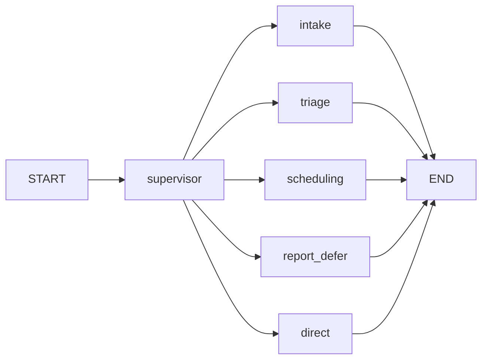
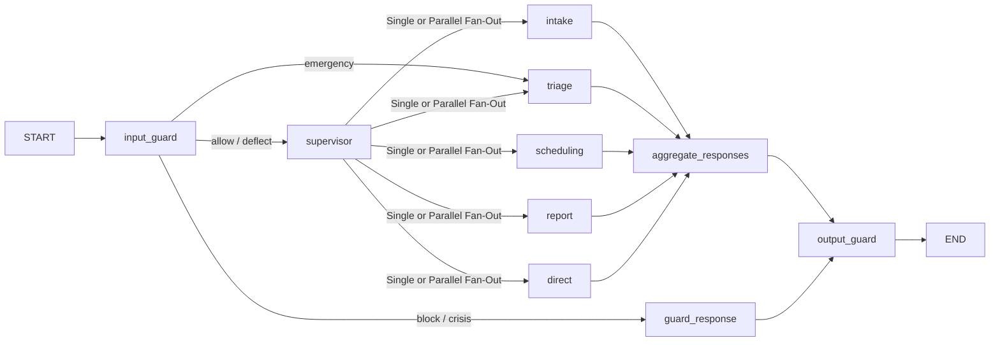

# CareFlow Architecture

CareFlow is a local, multi-agent care-coordination assistant. A patient chats in the browser; a LangGraph
pipeline routes each turn to a specialised agent that records structured clinical details, triages
urgency, or books a mock appointment. Every turn passes through safety guardrails on the way in and out.

## 1. Components

| Layer | File | Responsibility |
|---|---|---|
| UI | `index.html`, `carefree.html`, `app.js`, `styles.css`, `carefree.css` | Profile lookup/creation, chat threads, side panel with Symptoms / Treatment / Reports forms |
| HTTP server | `server_groq.py` | Stdlib `ThreadingHTTPServer`; serves static files and the JSON API |
| Orchestration | `orchestrator.py` | LangGraph `StateGraph`: guard nodes, supervisor router, agents |
| Guardrails | `guardrails.py` | Deterministic input/output safety rules, prompt-safety constants (see `docs/GUARDRAILS.md`) |
| Schemas / state | `models.py` | Pydantic clinical models (`MedicalCondition`, `Symptoms`, `Treatment`, `Reports`, `TimelineEvent`) and the `CareFlowState` TypedDict |
| Persistence | `database.py` | PostgreSQL when `DATABASE_URL` / `POSTGRES_URL` is set, otherwise SQLite `careflow.db` |
| LLM | Groq via `langchain_groq.ChatGroq` | Model from `GROQ_MODEL`, fallback `openai/gpt-oss-120b`; key from `GROQ_API_KEY` (env only) |
| Utilities | `inspect_db.py`, `clear_db.py`, `scripts/eval_guardrails.py` | DB inspection/reset, guardrail evaluation |

## 2. HTTP API (`server_groq.py`)

| Method & path | Purpose |
|---|---|
| `GET /api/profile?username=` | Full patient record (profile, aggregated forms, conditions, threads, active conversation) |
| `POST /api/profile` | Create profile (and its first conversation) |
| `POST /api/conversations` | New chat thread |
| `POST /api/conversations/select` | Switch active thread |
| `GET /api/conversations?username=&id=` | Load one thread with messages |
| `POST /api/chat` | One chat turn (below); response now includes `guardrail_flags` |
| `GET /api/guardrails?username=` | Guardrail audit events for a patient (new) |

## 3. Request lifecycle: `POST /api/chat`

1. Resolve the conversation (fallback: first conversation, or create one).
2. Save the user message to `chat_messages` immediately.
3. If it's the first message, set the thread title from it.
4. `run_orchestrator(username, session_id, user_input, follow_up_tracker)`:
   - loads the complete chat history of **this session** as LangChain messages
   - builds the initial `CareFlowState` (tracker from `conversations.follow_up_tracker`)
   - `careflow_graph.invoke(state)` runs synchronously, with no checkpointer
   - saves the updated `follow_up_tracker` back to the conversation row
5. Save the (guarded) assistant reply, and return the refreshed patient record plus `categories` and `guardrail_flags`.

## 4. LangGraph topology

Before guardrails:



Current (with Parallel Fan-Out, Report RAG, and Aggregator):



### Nodes

| Node | LLM calls | What it does |
|---|---|---|
| `input_guard` | 0 (1 if the domain is ambiguous) | `guardrails.check_input`: sanitize, self-harm, emergency, injection, diagnosis/prescription request, domain. Sets `guard_action`, `guard_rule`, `guardrail_flags`; logs to `guardrail_events` |
| `guard_response` | 0 | Returns the fixed template chosen by `input_guard` (crisis, injection, off-domain, empty) |
| `supervisor` | 0–1 | Emergency override (defence in depth), then keyword routes for scheduling/report/parallel fan-out, else LLM JSON routing; default `intake` |
| `intake` | 2 | (1) Extraction to `MedicalCondition`-shaped JSON with strict 24-hour onset format (`YYYY-MM-DD HH:MM`). (2) Slot-filling follow-ups. (3) Comfort advice. (4) Reply generation |
| `triage` | 1 | Urgency guidance; emergency line guaranteed by `output_guard` |
| `scheduling` | 1–2 | Extracts booking JSON; `db.book_appointment` writes a mock `confirmed` appointment |
| `report` | 1 | RAG-grounded retrieval across patient's baseline, conditions, memories, appointments, and timeline (`rag_report_engine.py`) |
| `direct` | 0 | Canned greeting |
| `aggregate_responses` | 0 | Merges parallel agent outputs (e.g. intake extraction + triage or report) with safety precedence |
| `output_guard` | 0 | `guardrails.check_output`: removes diagnostic assertions and unrequested medication/dose advice, strips markdown, prepends deflection/emergency lines, adds disclaimer, truncates; logs flags |

### State (`models.CareFlowState`)

| Field | Reducer | Meaning |
|---|---|---|
| `messages` | `add_messages` | Full session history + replies |
| `active_conditions` | `ior` | Condition records touched this turn |
| `follow_up_tracker` | `ior` | `"{disease}_{topic}_asked"` → bool; persisted per conversation |
| `next_agent` | replace | Supervisor's routing decision |
| `username`, `session_id`, `user_input` | replace | Turn inputs (`user_input` is replaced by the sanitized text) |
| `response_text`, `categories` | replace | Reply and UI form tags |
| `guard_action`, `guard_rule` | replace | Input-guard decision (`allow`/`deflect`/`emergency`/`crisis`/`block`) and rule name |
| `guardrail_flags` | `add` | `[{stage, rule, action}]` from both guards |
| `agent_responses` | `ior` | Responses from agents executed in parallel |
| `parallel_agents` | `add` | List of all agent nodes activated this turn |
| `rag_report_context` | replace | Grounding medical history context retrieved for report generation |

## 5. Data model

```mermaid
erDiagram
  patient_profiles ||--o{ conversations : has
  conversations ||--o{ chat_messages : contains
  patient_profiles ||--o{ medical_conditions : has
  patient_profiles ||--o{ appointments : books
  conversations ||--o{ guardrail_events : audits
  patient_profiles { text username PK; text name; text date_of_birth; text height; text weight }
  conversations { text id PK; text username FK; text title; text follow_up_tracker; int pending_treatment_index }
  chat_messages { text id PK; text session_id FK; text sender; text message; text categories }
  medical_conditions { int id PK; text username FK; text disease_name; text chief_complaint; text onset; int severity_score; text raw_data }
  appointments { text id PK; text username FK; text doctor_type; text preferred_date; text preferred_time; text status }
  guardrail_events { text id PK; text session_id; text username; text stage; text rule; text action; text excerpt }
```

- `medical_conditions` is unique on `(username, disease_name)`; `raw_data` holds the full merged JSON
  (symptoms, treatments, reports, timeline). `upsert_condition` deep-merges and ignores empty values.
- `get_patient_aggregate_forms` flattens all conditions into the UI's Symptoms / Reports / Treatment forms.
- `guardrail_events` has no FK on purpose, so audit rows survive conversation deletion.

## 6. Known weaknesses

| Issue | Status |
|---|---|
| Groq API key hardcoded in `orchestrator.py` and `l.py` | **Fixed**: env only, fails fast if missing. The old key was in plaintext and **must be rotated** |
| Raw patient text pasted into system prompts (prompt injection) | **Fixed**: text goes only in the user turn, wrapped in `<patient_message>` tags, with data-only rules |
| Intake told the LLM to name OTC drugs (e.g. paracetamol) | **Fixed**: comfort measures only; output guard removes drug/dose advice |
| Off-topic text routed to intake and saved as a condition | **Fixed**: input-guard domain check + intake skips upsert without clinical content |
| No diagnosis deflection | **Fixed**: input deflection + output removal of diagnostic assertions |
| Emergency detection by substring; emergency text not guaranteed | **Fixed**: regex detector, forced triage, guaranteed emergency line |
| No audit trail of safety decisions | **Fixed**: `guardrail_events` + `GET /api/guardrails` |
| Memory is only the last 8 messages of the current session; extraction sees only the latest condition | **Fixed**: Full session message history sent to LLM + Autonomous LTM Consolidation Agent (`memory_agent.py`) with `patient_memories` and `patient_baseline_summaries` |
| No RAG grounding for advice | Open (RAG work) |
| New DB connection per call; SQLite FKs not enforced (`PRAGMA foreign_keys` off) | Open |
| No authentication: any username can be loaded | Open |
| `LLM_INTEGRATION.md` described the pre-LangGraph design | Marked legacy |

## 7. Long-Term Memory (LTM) Architecture

CareFlow implements an **Agent-Written, Self-Consolidating Long-Term Memory (LTM)** layer:
1. **Persistence Tables**:
   - `patient_memories`: Atomic, indexed clinical observations (type, content, confidence, status: active/contradicted/resolved).
   - `patient_baseline_summaries`: Versioned clinical baseline (chronic conditions, active medications, allergies, synthesized general summary).
2. **Autonomous Background Consolidation (`memory_agent.py`)**:
   - After each turn, an asynchronous daemon thread triggers `consolidate_patient_memory(username, session_id)`.
   - Reconciles new dialogue with past memories, invalidates contradicted records, and synthesizes an updated clinical baseline.
   - Autonomously generates and updates a human-readable Markdown summary in `reports/{username}_memory_profile.md`.
3. **In-Turn Memory Injection (`orchestrator.py`)**:
   - The Intake Agent loads the patient's consolidated baseline and active memories into its clinical prompt context across all past sessions.

